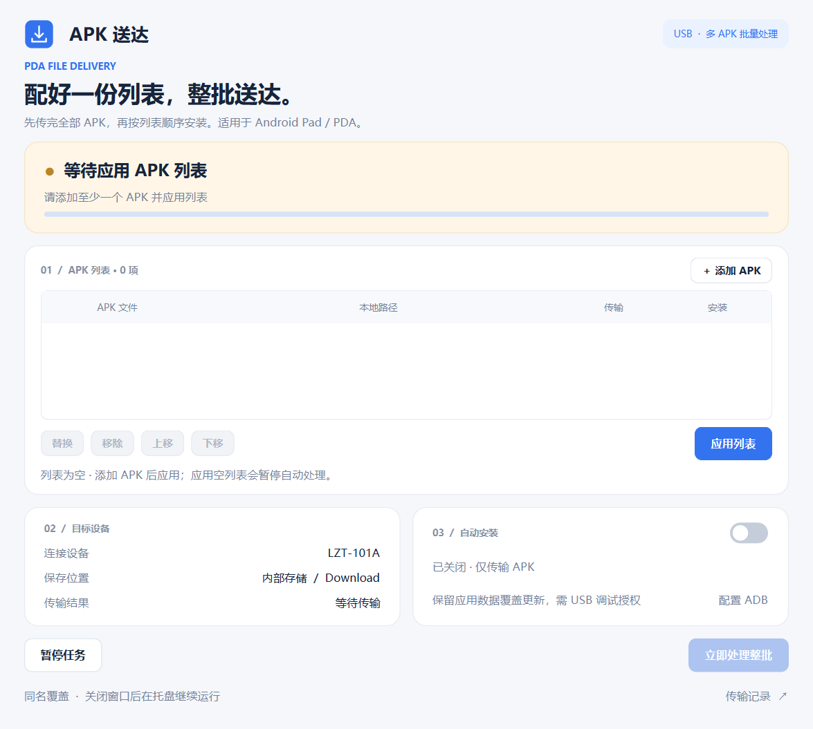

<div align="center">

# APK 送达

**选好 APK，连接即传。**

一个为 Android Pad / PDA 交付场景准备的 Windows 小工具。配置电脑上的 APK 列表，接入一台设备，先全部传到内部存储的 `Download`，再按需逐个安装。

v1.2.0 新增多 APK 列表：添加多少就处理多少，可排序、逐项查看结果。多 APK 功能需要 v1.2.0 或更新版本；自动安装每次启动默认关闭。

[下载 Windows 版](https://github.com/Mai-Mu/qzz-apk-placer/releases/latest) · [使用说明](docs/USER_GUIDE.md) · [开发与构建](docs/DEVELOPMENT.md) · [更新记录](CHANGELOG.md)




</div>

## 它能做什么

- **接入批量处理**：每次设备接入且存储可访问时，自动处理整份已应用的列表；程序启动前已连接的设备也能处理。
- **同名直接覆盖**：目标始终为内部存储的 `Download`，其他名称的文件保留。
- **列表编辑与保存**：多选或分次添加不同目录的 APK，可替换、移除和排序；点击「应用列表」后保存生效。
- **先传完再安装**：先尝试传输全部文件，再按顺序安装成功传输的项；单项失败继续处理其他项。
- **托盘后台运行**：关闭窗口后继续等待接入，从右下角托盘恢复、暂停或退出。
- **清楚的状态反馈**：显示设备、单项进度与结果、失败原因和整批汇总。
- **可选自动安装**：开关每次启动默认关闭，对下一批任务生效；保留应用数据覆盖更新，等待授权时不重复复制。

程序通过 Windows 原生 WPD/MTP 接口传输文件。仅传输时无需 ADB 或 USB 调试；启用自动安装时需配置 Android ADB 并授权电脑。当前按**一次连接一台 PDA**设计。

## 下载和使用

1. 打开 [最新版本](https://github.com/Mai-Mu/qzz-apk-placer/releases/latest)，下载名称以 `windows-x64.zip` 结尾的压缩包。
2. 解压整个压缩包，双击文件夹内的 `QzzApkPlacer.exe`。请保留旁边的 `_internal` 文件夹，无需另装 Python。升级时先从旧版托盘菜单退出程序，再运行新版。
3. 点击「添加 APK」选择一个或多个安装包，也可以分次从不同目录添加；按需要排序后点击「应用列表」。
4. 用支持数据传输的 USB 线连接 Pad / PDA，解锁设备并选择 **文件传输 / MTP**。
5. 等待批次结束，检查每行的传输、安装结果及顶部汇总；未启用自动安装时可在设备的 Download 中打开安装包。

默认只传输文件。需要自动安装时，先准备 [官方 Platform-Tools](https://developer.android.com/tools/releases/platform-tools)，通过「配置 ADB」选择 `adb.exe`，在设备上开启 USB 调试并授权电脑，再开启自动安装。已完成的批次不会因切换开关追溯安装，可点击「立即处理整批」开始新批次。

## 传输规则

| 场景 | 程序行为 |
| --- | --- |
| 设备新接入，且内部存储可访问 | 自动执行已应用列表的一批任务 |
| 设备一直连接 | 已结束的批次不自动重复，可手动处理整批 |
| 增删、替换、排序列表 | 作为草稿，点击「应用列表」才生效；已连接时开始新批次 |
| 任一 APK 路径失效、为空或不可读 | 整批暂停，修正或删除后重新应用 |
| 原路径的 APK 内容更新 | 不自动重传，可点击「立即处理整批」 |
| Download 已有同名 APK | 删除目标同名文件，再写入当前版本 |
| 某项传输失败 | 继续传其他项，只安装成功传输的文件，最后汇总 |
| 识别到多个 USB 便携设备 | 暂停，保留一台目标设备后继续 |
| 不能确定内部存储 | 停止本次传输并提示 |
| 不同目录的 APK 文件名相同 | 禁止同时添加，提示先重命名 |
| 同一文件重复添加 | 自动忽略重复项 |
| 自动安装关闭 | 只传输 APK；每次启动均恢复为关闭 |
| 开关由关闭改为开启 | 下一次传输任务生效，已完成任务不追溯安装 |
| 已传输，但调试连接或授权未就绪 | 保留稳定副本并等待，条件就绪后继续安装 |
| 安装签名冲突、降级被拒绝或其他安装失败 | 显示原因，保留传输结果，不自动卸载、不无限重试安装 |

覆盖期间请保持连接，等显示成功再拔线。传输前会生成稳定的本地副本，写入提交完成并核对设备文件大小后才显示成功。

## 从源码运行

需要 Windows、Python 3.10 或更高版本。已验证的开发环境为 Windows 11 x64 / Python 3.12；其他 Windows 环境和 PDA 型号的兼容情况见 [验证记录](TESTING.md)。

```powershell
git clone https://github.com/Mai-Mu/qzz-apk-placer.git
cd qzz-apk-placer
python -m venv .venv
.\.venv\Scripts\python.exe -m pip install -r requirements.txt
.\.venv\Scripts\python.exe main.py
```

也可使用已安装好依赖的 Python，运行 `python main.py` 或双击 `启动程序.bat`。

## 开发与验证

```powershell
# 运行单元与流程测试
python -m unittest discover -s tests -v

# 构建 Windows 可执行程序
powershell -ExecutionPolicy Bypass -File .\build.ps1

# 整理版本压缩包和 SHA-256 校验文件
python scripts/package_release.py
```

60 项自动化测试通过。LZT-101A（Android 13）实测两个 APK 先传完再安装，以及第一个签名冲突失败后第二个继续更新、私有数据保留。完整范围见 [TESTING.md](TESTING.md)。历史 v1.1.0 另在 IT-400i（Android 9）验证过单 APK 安装与更新。

## 常见问题

**电脑能充电，程序却找不到设备？** 先确认 Windows「此电脑」里能打开 PDA 的内部存储；检查数据线、设备解锁状态及 USB 文件传输模式。

**关闭窗口后怎么退出？** 右键系统托盘的「APK 送达」图标，选择「退出程序」。

**日志保存在哪里？** `%LOCALAPPDATA%\QzzApkPlacer\`，包括路径设置、滚动日志及启动异常记录。反馈问题时请先去除日志中的客户文件名和本地路径等信息。

更多说明见 [使用指南](docs/USER_GUIDE.md)。反馈问题可使用 [GitHub Issues](https://github.com/Mai-Mu/qzz-apk-placer/issues)，建议注明系统、PDA 型号和复现步骤。

## 技术组成

Python · PySide6 · comtypes · Windows Portable Devices · PyInstaller

项目结构、实现边界与构建方法见 [开发文档](docs/DEVELOPMENT.md)，依赖信息见 [第三方组件说明](THIRD_PARTY.md)。
